<div align="center">



[English](README.md) · [简体中文](README.zh-CN.md) · **日本語**

[](LICENSE)
[](https://vpm.dreamo.ink/)


</div>

UniText は、VRChat の PC 版アバター上に**同じインスタンス内の全 PC プレイヤーから見えるリアルタイムの多言語字幕・翻訳（日本語 / 中国語 / 韓国語 / 英語 / Unicode BMP）**を表示できる仕組みです。VRChat 標準チャットボックスの制限を突破します。

---

## 主な特徴

- **Unicode BMP フル対応 & プロポーショナルレイアウト**: 行幅 `192–640 px`（デフォルト `384 px`）× 表示行数 `4–12` 行（デフォルト `6` 行）を設定可能。`UniText_Bank` により 1 行あたり最大 `64` セル、オプションの `+1 bit`（`UniText_RowPage`）により `7–12` 行に対応します。
- **超省メモリ VRAM フットプリント（約 `712 KB`）**: ブロックインデックス圧縮フォントアトラス（`680 KB`）+ 統合補助テーブル（`16 KB`）+ CRT / ParamBridge（`16 KB`）。
- **高効率エンコード & ゼロコピースクロール**: 12-bit 頻出文字 LUT（`4,096` グリフ）+ 1 バイトページ圧縮（`0x30` 仮名・CJK 句読点など）+ リングバッファによるハードウェアスクロール。
- **豊富な表現とゲーム内リアルタイム調整**: 行ごとの 16 色パレット、Dim / Highlight スタイル、ステータスインジケーター、SPS-I ステレオ対応ビルボード & World Drop（`VRCParentConstraint`）、さらに `CMD_SET_GEOMETRY` によるリアルタイムな幅・高さ変更と自動折り返し（軸パラメータ自体は同期 `0` bit）。
- **NDMF + Modular Avatar 非破壊ワークフロー**: アバター元の Animator Controller、Expression Parameters、Expressions Menu アセットを直接書き換えることはありません。

---

## 動作要件

| 依存パッケージ | バージョン | 備考 |
| :--- | :--- | :--- |
| **Unity** | `2022.3.22f1` | VRChat SDK3 対応 Unity エディター |
| **VRChat SDK - Avatars** | `>= 3.7.0` | `com.vrchat.avatars`（VPM 経由で自動導入） |
| **Modular Avatar** | `>= 1.10.0` | `nadena.dev.modular-avatar`（VPM 経由で自動導入） |
| **NDMF** | `>= 1.5.0` | `nadena.dev.ndmf`（VPM 経由で自動導入） |

---

## クイックインストール（VCC / VPM）

1. **[Dreaminko の VPM リポジトリを VCC に追加](vcc://vpm/addRepo?url=https://vpm.dreamo.ink/index.json)** をクリックする（または [Dreaminko VPM リポジトリ](https://vpm.dreamo.ink/) を開く）か、VCC の `Settings → Packages → Add Repository` から以下の URL を手動で追加します：
   ```text
   https://vpm.dreamo.ink/index.json
   ```
2. VCC でアバタープロジェクトを開き、**Dreaminko's VPM Repository** から **`UniText`**（`dev.dreaminko.unitext`）を追加します。`com.vrchat.avatars`、`nadena.dev.modular-avatar`、`nadena.dev.ndmf` は自動的にインストールされます。
3. Unity（`2022.3.22f1`）を開き、上部メニューバーの **`UniText → Install to Avatar`**（または **`Tools → UniText → Install to Avatar`**）をクリックし、Scene Hierarchy から **Avatar** をドラッグ＆ドロップしてティアと配置を選び、**Install** をクリックします（または `Packages/dev.dreaminko.unitext/Prefabs/` 内のプレハブを Avatar ルート直下に手動配置してください）。アップロードまたは Play Mode でプレビューできます。

---

## Modular Avatar 非破壊セットアップ（`UniTextProp`）

UniText のプレハブは、アバターの Animator Controller、Expression Parameters、Expressions Menu ファイルをディスク上で改変しません。アバターのビルド時または Play Mode 開始時に内蔵 NDMF プラグイン（`UniTextNdmfPlugin`）が Modular Avatar の直前で動作し、各 `UniTextProp` をクリーンに展開します：

- **自動ボーン追従（`MA Bone Proxy`）**: `SideFollowAnchor` を指定された Humanoid ボーン（デフォルトは `Chest`、自動オフセット調整対応）に配置し、`BoardPivot` を `VRCParentConstraint` で接続してサイド追従と World Drop をシームレスに切り替えます。
- **Direct BlendTree FX マージ（`MA Merge Animator`）**: 選択したティア用の Direct BlendTree FX レイヤーをメモリ上で生成し、`MergeAnimatorPathMode.Relative` および `matchAvatarWriteDefaults = true` でマージします。
- **パラメータ自動登録（`MA Parameters`）**: `UniText_Visible`、`UniText_Ctrl`、`UniText_D0..D{N-1}`、オプションの同期パラメータ `UniText_WorldDrop`、`UniText_Bank`（ワイド行）、`UniText_RowPage`（`> 6` 行）、およびローカル専用 UI 操作（`Width`、`Height`、`Scale`、`Opacity`）とジオメトリマーカー（`UniText_Rows`、`UniText_RowPx8`）を登録します。
- **編集可能な階層サブメニュー（`MA Menu Installer` + `MA Menu Item`）**: プレハブ配下に編集可能な `"UniText"` サブメニュー階層（`MA Menu Installer` + `MA Menu Item`）を生成し、Hierarchy 上で名称変更・アイコン設定・並び替え・デフォルト値調整や他メニューへの移動を直接行えます（未生成の場合はビルド時に自動フォールバック生成されます）。
- **Quest / Android 自動ストリップ**: `stripOnAndroid` が有効（デフォルト）の場合、Android ビルド時に PC 側のプレハブ設定を変更せず UniText を自動的に除外します。

### ゲーム内 Expressions Menu 操作

VRChat の Expressions Menu 内 **`UniText`** サブメニューから以下を操作できます：

- **Show Board**: 字幕ボードの表示 / 非表示を切り替え（`UniText_Visible`）
- **World Drop**: ワールド空間に固定、またはアバター追従へ戻す（`UniText_WorldDrop`）
- **Billboard**: ステレオ対応のカメラ正対モードを切り替え（`UniText_Billboard`）
- **Clear Screen**: ローカルの字幕バッファをクリア（`UniText_LocalClear`）
- **Appearance** *（サブメニュー）*:
  - **Scale**: ボードの物理サイズを調整（`UniText_Scale`）
  - **Opacity**: 背景・文字の不透明度を調整（`UniText_Opacity`）
  - **Width** & **Height**: 1 行あたりの幅と表示行数をリアルタイムに再配置（`UniText_Width`、`UniText_Height`）

---

## パラメータ予算ティア

| ティア | プレハブ | 同期ビット数 | ペイロード | LUT12 CJK / Pkt | Page (`0x30`) / Pkt | UTF-16 / Pkt | ASCII / Pkt | 推奨用途 |
| :--- | :--- | :---: | :---: | :---: | :---: | :---: | :---: | :--- |
| **Lite** | `Board_Lite_33b.prefab` | **33 bits** | 3B (`D0..D2`) | 2 | 2 | 1 | 3 | 非常に厳しいパラメータ予算向け（高速リングバッファスクロール） |
| **Compact** | `Board_Compact_45b.prefab` | **45 bits** | 36b (`D0..D3` + `D4b4..D4b7`) | 3 | 3 | 2 | 4 | 省パラメータ向け（Lite 比で CJK 速度 +50%） |
| **Balanced** | `Board_Balanced_57b.prefab` | **57 bits** | 6B (`D0..D5`) | 4 | 5 | 3 | 6 | パラメータ消費と CJK 速度のバランス重視（Standard 比 -16 bit） |
| **Standard** *(デフォルト)* | `Board_Standard_73b.prefab` | **73 bits** | 8B (`D0..D7`) | 5 | 7 | 4 | 8 | 多くのアバター向け（推奨） |
| **Turbo** | `Board_Turbo_137b.prefab` | **137 bits** | 16B (`D0..D15`) | 10 | 15 | 8 | 16 | 最低遅延を重視する場合 |

### オプション同期ビットと VRAM 内訳

- **World Drop 同期（`+1 bit`）**: `UniText_WorldDrop` の同期に `+1 bit` 使用します（デフォルト有効：他プレイヤーからもワールド固定された状態が見えます。不要な場合は `UniTextProp` または `ModularAvatarParameters` でローカル専用に変更可能）。
- **ワイド行対応（`+1 bit`）**: `UniText_Bank`（`syncWideRows`、デフォルト有効）に `+1 bit` 使用し、1 行あたり最大 `64` セルの比例文字を保持できます（英語の収容文字数が約 2 倍になります）。無効時はプロポーショナル描画を維持したまま `32` セル/行になります。
- **拡張行数対応（`> 6` 行またはライブサイズ変更有効時 `+1 bit`）**: `UniText_RowPage`（`+1 bit`）により `7..12` 行表示に対応します。
- **ライブサイズ変更 & リフロー（`+1 bit`、デフォルト有効）**: `UniText_Width` と `UniText_Height` 自体はローカル専用（`0` 同期ビット）です。[VRCS](https://github.com/Dreaminko/VRCS) が再計算した `(rows, row_px)` を `CMD_SET_GEOMETRY` でローカル・リモート双方に送信するため、`Allow In-Game Resize` を有効にしても消費するのは `UniText_RowPage` の `+1 bit` のみです（無効化で `1` bit 節約可能）。
- **ローカル専用 UI コントロール & 機能マーカー（`0` 同期ビット）**: `UniText_ProtoVer`、`UniText_Rows`、`UniText_RowPx8`、`UniText_Width`、`UniText_Height`、`UniText_Billboard`、`UniText_Scale`、`UniText_Opacity`、`UniText_LocalClear`。
- **VRAM フットプリント**: ブロックインデックス圧縮アトラス（`FontAtlas_BMP_Packed.png`、`680 KB`）+ 統合補助テーブル（`UniTextAux_64x64.png`、`16 KB`）+ CRT / ParamBridge（`16 KB`）≈ 合計 **`712 KB`**。
- **パラメータ残量の確認**: Unity の **`Tools → UniText → Check Avatar Parameter Budget`** からアバターの空きパラメータを確認できます。衣装やスライダー等でビット数が逼迫している場合は、アバター側の静的メニューパラメータに対してのみ **VRCFury Parameter Compressor** を併用してください（UniText のリアルタイム OSC データパラメータは圧縮しないでください）。

---

## Android / Quest に関する注意

VRChat Quest / Android アバターでは `CustomRenderTexture` の更新およびマルチパス CRT シェーダーがサポートされていません。`UniTextProp` のデフォルト設定（`stripOnAndroid = true`）により、NDMF プラグインが Android ビルド時にギミックを非破壊で自動除去するため、クロスプラットフォーム対応アバターでもシェーダーエラーなしで安全にビルドできます。

---

## 開発者向けクイックスタート

### 1. 自動テストスイートの実行
```bash
python tools/test_all.py
```

### 2. フォントアトラス検証と LUT12 コードブックの再生成
```bash
python tools/font-atlas/verify_atlas.py
python tools/font-atlas/generate_lut12.py
```

### 3. ローカル VRChat / Unity (`127.0.0.1:9000`) へのテスト字幕送信
```bash
pip install -r tools/osc-tester/requirements.txt
python tools/osc-tester/send_demo.py --verify-vectors
python tools/osc-tester/send_demo.py --tier balanced --interval 150 --mode bundle --demo long --loop
python tools/osc-tester/send_demo.py --tier lite --interval 150 --demo scroll --loop
python tools/osc-tester/send_demo.py --oscquery-url http://127.0.0.1:9001/avatar/parameters --tier auto --demo long
```

### 4. Unity でのパッケージ検証と `.unitypackage` エクスポート
**Unity 2022.3.22f1** で `unity/` プロジェクトを開きます（VCC/VPM により `com.vrchat.avatars`、`nadena.dev.modular-avatar`、`nadena.dev.ndmf` が解決されている状態）：
- `Packages/dev.dreaminko.unitext/Prefabs/` 配下のプレハブは事前ベイク不要で、**NDMF + Modular Avatar 経由ですぐに利用可能**です。
- メンテナーは以下のメニューからアセット参照の検証・更新やオフライン `.unitypackage` のエクスポートを行えます：
  - **`Tools → UniText → Verify & Refresh Package Assets`**
  - **`Tools → UniText → Export .unitypackage`**

---

## ドキュメント & ライセンス

- [プロトコル仕様 (`v2`)](docs/PROTOCOL.md) — CRT メモリレイアウト、OSC パラメータ、コマンド仕様、送信側ルール
- [カスタムスキン & ギミック作成ガイド](docs/SKIN_GUIDE.md) — `UniTextCommon.cginc` API とカスタムシェーダー開発
- [プロトコルテストベクター](spec/test-vectors.json) — 送信アプリ実装向けの検証用リファレンスベクター
- [サードパーティライセンス](THIRD_PARTY_LICENSES.md) — 同梱の [Fusion Pixel Font](https://github.com/TakWolf/fusion-pixel-font)（`SIL OFL-1.1`）、[Google Material Symbols](https://github.com/google/material-design-icons)（`Apache-2.0`）および依存ライブラリの帰属表記
- [MIT License](LICENSE)
